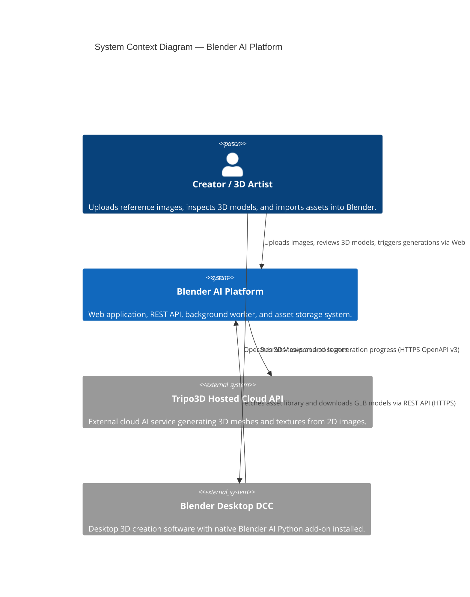
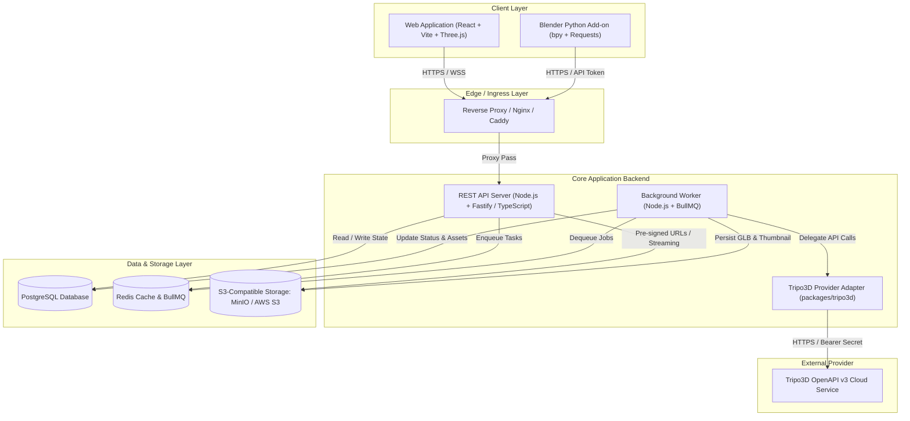
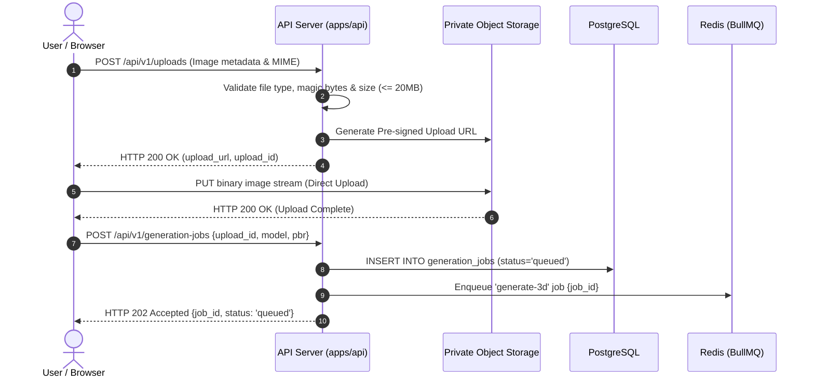
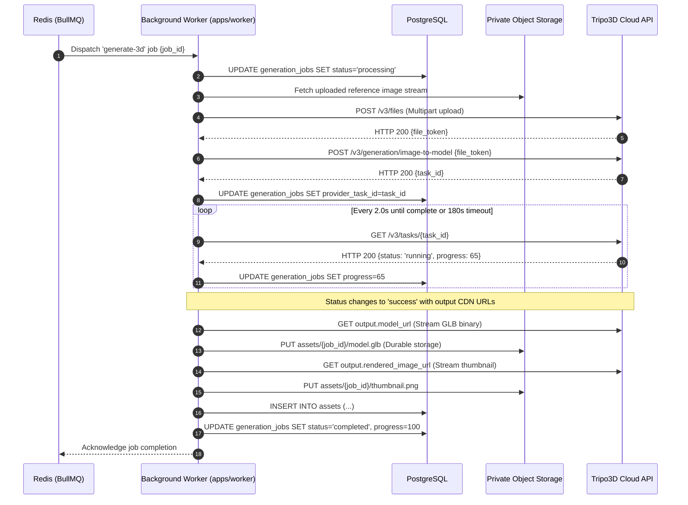
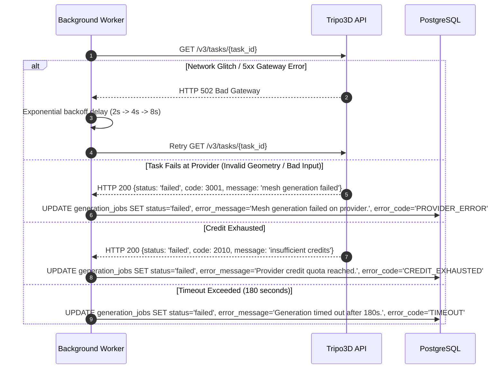

# System Architecture & Technical Design

**Document Version:** 1.0.0  
**Status:** Approved Architecture Baseline  
**Lead Architect:** Principal Software Architect  

---

## 1. Architecture Overview

### 1.1 Verified Current Architecture
* **Current State:** Greenfield baseline (0 lines of code, newly initialized Git repository).
* **Reference Baseline:** Documented in [docs/repo-audit.md](file:///C:/Users/user5/.gemini/antigravity-ide/scratch/Blender-Ai/docs/repo-audit.md).

### 1.2 Target Architecture: Modular Monolith with Asynchronous Queue Worker
To satisfy the requirements of long-running 3D generative inference (15–120 seconds), strict secret isolation (`TRIPOSR_API_KEY`), durable storage before CDN expiration, and seamless Blender integration without unnecessary microservice complexity, Blender AI is engineered as a **Modular Monolith with an Asynchronous Job Worker**.

---

## 2. System Context Diagram (C4 Level 1)

---

## 3. Container & Component Architecture (C4 Level 2)

---

## 4. Why Asynchronous Background Processing is Mandatory

In modern web development, HTTP requests through reverse proxies, load balancers, and browser network stacks have strict connection timeouts (typically 15 to 30 seconds). 

AI 3D mesh reconstruction takes between **15 and 120 seconds**, occasionally longer when provider GPU nodes are scaling. If the web client were to trigger generation synchronously via a single HTTP request:
1. **Network Timeouts:** Reverse proxies would drop the connection with an HTTP 504 Gateway Timeout.
2. **Client Fragility:** If the user refreshed or closed their browser tab, the execution context would terminate, orphaning the cloud generation and wasting paid API credits.
3. **CDN Link Expiration:** Tripo3D's output CDN links expire in approximately **5 minutes**. If the client receives a link directly and does not download it immediately, the asset is lost forever.

**Solution:** The backend API immediately writes a job to PostgreSQL in `queued` status and enqueues a lightweight message into Redis BullMQ (< 50ms response). The client receives an HTTP 202 Accepted with a `job_id`. The dedicated worker manages the polling loop and downloads the output GLB directly into durable private storage before marking the job `completed`.

---

## 5. End-to-End Sequence Diagrams

### 5.1 Image Upload & Job Enqueuing Flow

---

### 5.2 Background Worker & Tripo3D Generation Flow

---

### 5.3 Asset Download & Blender Add-on Import Flow

```mermaid
sequenceDiagram
    autonumber
    actor Artist as 3D Artist
    participant Blender as Blender Add-on (bpy)
    participant API as API Server (apps/api)
    participant DB as PostgreSQL
    participant Storage as Private Object Storage

    Artist->>Blender: Open 3D Viewport -> Sidebar "Blender AI"
    Blender->>API: GET /api/v1/assets (Bearer user_api_token)
    API->>DB: Query user's completed assets
    DB-->>API: Return asset records
    API-->>Blender: JSON [ {id, name, thumbnail_url, polycount} ]
    Blender-->>Artist: Render asset thumbnail gallery in N-panel

    Artist->>Blender: Click "Import into Scene" on Asset #42
    Blender->>API: GET /api/v1/assets/42/download
    API->>Storage: Generate Pre-signed Download URL (15-min TTL)
    API-->>Blender: HTTP 200 {download_url}
    
    Blender->>Storage: GET /assets/.../model.glb
    Storage-->>Blender: Stream binary GLB data
    Blender->>Blender: Save temporary local file (.glb)
    Blender->>Blender: bpy.ops.import_scene.gltf(filepath=...)
    Blender->>Blender: Auto-center origin, snap to Z=0, frame viewport
    Blender-->>Artist: 3D model appears in scene with PBR materials
```

---

### 5.4 Failure & Retry Sequence

---

## 6. Trust Boundaries & Security Architecture

1. **Public Internet -> API Gateway (Trust Boundary 1):**
   - TLS 1.3 encryption.
   - Strict CORS policy limiting requests to the web application domain.
   - Rate limiting on generation endpoints.
2. **API Server -> Database & Redis (Trust Boundary 2 - Internal Network):**
   - Database credentials managed via private environment variables.
   - Object storage access uses IAM roles or dedicated private S3 credentials.
3. **Backend Worker -> Tripo3D API (Trust Boundary 3 - External Egress):**
   - Egress secured with HTTPS.
   - `TRIPOSR_API_KEY` is loaded strictly in server-side process environments and never transmitted to clients.
4. **API Server -> Blender Add-on (Trust Boundary 4):**
   - Authenticated via personal user API tokens (UUIDv4 / Bearer tokens).
   - Scoped strictly to asset read and download permissions.

---

## 7. Component Responsibilities & Technology Stack

| Component | Technology | Primary Responsibilities |
| :--- | :--- | :--- |
| **Frontend Web** | React 18, Vite, TypeScript, Vanilla CSS | UI/UX, image dropzone, WebGL 3D preview canvas, job polling, responsive layouts. |
| **3D Canvas** | Three.js, OrbitControls, GLTFLoader | Real-time WebGL rendering, PBR material evaluation, wireframe toggle, camera controls. |
| **Backend API** | Node.js (v20 LTS), Fastify / TypeScript | REST endpoints (`/api/v1`), upload validation, authentication, job orchestration. |
| **Queue Worker** | BullMQ, Redis (v7) | Background execution, Tripo3D polling, asset streaming from CDN to storage. |
| **Provider Adapter** | `packages/tripo3d` (TypeScript) | Isolates Tripo3D OpenAPI v3 calls, provides mock fixtures for automated tests. |
| **Relational DB** | PostgreSQL 16 | Relational data persistence: `users`, `generation_jobs`, `assets`, `asset_events`. |
| **Object Storage** | MinIO (Dev) / AWS S3 or Cloudflare R2 (Prod) | Secure binary storage for uploaded input images, generated `.glb` models, and thumbnails. |
| **Blender Add-on** | Python 3.10+, Blender `bpy` API | In-viewport N-panel UI, asset browsing, automatic glTF scene importing. |

---

## 8. Scaling Strategy & Architectural Limits

- **Horizontal API Scaling:** The Fastify API server is stateless; multiple instances can sit behind a load balancer.
- **Worker Concurrency:** BullMQ worker instances scale horizontally based on Redis queue depth (`generate-3d` job count).
- **Storage Scalability:** S3-compatible storage scales elastically without application intervention.
- **Tripo3D Quota Limit:** System throughput is bounded by the Tripo3D account concurrency tier (default: 10 concurrent generation tasks). BullMQ's rate-limiter ensures requests stay within provider allowances.
