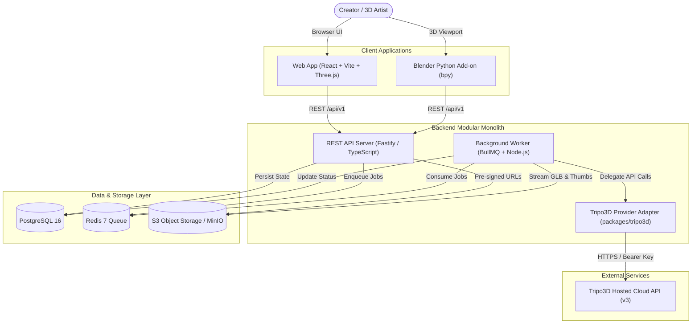

# Blender AI

> **Generate genuine 3D models from 2D reference images and import them directly into Blender.**

Blender AI bridges generative AI and 3D modeling pipelines. Upload a reference image through an intuitive web application, convert it into a textured 3D mesh via the hosted Tripo3D cloud API, preview and inspect the geometry in an interactive WebGL viewport, store the asset durably in private object storage, and import it into Blender with a single click using our native Python add-on.

---

## 1. Problem & Solution

* **The Problem:** 3D asset creation requires extensive manual labor (box modeling, sculpting, retopology, UV unwrapping, and texturing). Generative 3D tools exist, but they are often isolated web toys that yield temporary download links (expiring within minutes), require awkward file conversions, and lack direct integration into digital content creation (DCC) software like Blender.
* **The Solution:** Blender AI provides a complete end-to-end pipeline:
  1. **Fast Upload & Validation:** Secure client-side and backend image inspection (PNG/JPEG up to 20MB).
  2. **Asynchronous Generation:** Background job processing with BullMQ and Redis that reliably polls Tripo3D's hosted API without HTTP timeouts.
  3. **Immediate Durability:** Automatically streams generated `.glb` models from Tripo's temporary CDN into private S3-compatible storage before CDN links expire.
  4. **Interactive WebGL Preview:** Full 3D inspection in the browser using Three.js with OrbitControls, PBR materials, and wireframe toggle.
  5. **Native Blender Integration:** A dedicated Python add-on inside Blender's 3D Viewport (`N-panel`) that connects to your account and imports models with correct scale and ground alignment.

---

## 2. Current Implementation Status

> [!NOTE]
> **Baseline Status:** The repository has completed **Stage 0: Architectural and Engineering Foundation**. The codebase is currently in the documentation-first foundation phase; complete architecture, database schemas, REST contracts, and provider integrations are specified and locked. Full implementation begins in **Stage 1**.

| Feature Area | Current Status | Notes |
| :--- | :--- | :--- |
| **Architectural Specifications & Documentation** | **Verified Complete** | Complete foundation in `docs/` and root `.md` files |
| **Repository Baseline Audit** | **Verified Complete** | Greenfield Git repository on `main` branch |
| **Tripo3D OpenAPI v3 Integration Specs** | **Verified Complete** | Official endpoints, schemas, polling, and mock rules documented |
| **Project Workspace Scaffolding** | *Pending (Stage 1)* | Monorepo structure, linters, and build tooling |
| **PostgreSQL Database & Migrations** | *Planned (Stage 1)* | Schema defined in `schema.md` |
| **Image Upload & S3 Pipeline** | *Planned (Stage 2)* | Direct pre-signed uploads with magic-byte checks |
| **Tripo3D Adapter & BullMQ Worker** | *Planned (Stage 3)* | Asynchronous queue with mock test harness |
| **Three.js WebGL 3D Previewer** | *Planned (Stage 4)* | In-browser 3D viewport |
| **Asset Library & Downloads** | *Planned (Stage 5)* | Signed URL downloads and asset history |
| **Blender Python Add-on** | *Planned (Stage 6)* | N-panel viewport integration with `bpy` |

---

## 3. System Architecture



---

## 4. Technology Stack

- **Frontend:** React 18, Vite, TypeScript, Vanilla CSS (Dark Blender-inspired theme), Three.js (WebGL 3D Viewer).
- **Backend API:** Node.js (v20 LTS), Fastify / Express, TypeScript.
- **Queue & Worker:** BullMQ, Redis 7.
- **Database:** PostgreSQL 16 (Prisma ORM / Kysely).
- **Object Storage:** S3-compatible storage (MinIO locally; AWS S3 or Cloudflare R2 in production).
- **AI 3D Provider:** Tripo3D Hosted API (OpenAPI v3).
- **Desktop Add-on:** Python 3.10+, Blender `bpy` API (Blender 3.6 LTS & 4.x).
- **Infrastructure:** Docker Compose.

---

## 5. Repository Directory Structure

```
Blender-Ai/
├── .env.example               # Environment variable template
├── .gitignore                 # Standard Node, Python, Blender & storage ignores
├── README.md                  # Project landing page & documentation overview
├── PRD.md                     # Product Requirements Document
├── ARCHITECTURE.md            # System architecture, C4 diagrams, sequence flows
├── design.md                  # UI/UX design tokens, layout specs & Three.js controls
├── schema.md                  # PostgreSQL relational schema & Mermaid ER diagram
├── API.md                     # REST API specification (/api/v1)
├── AGENTS.md                  # Permanent instructions for Google Antigravity & agents
├── ROADMAP.md                 # 10-stage development plan (Stage 0 to Stage 9)
├── SECURITY.md                # Security policy, upload validation, secret handling
├── DEPLOYMENT.md              # Deployment runbook (Docker Compose & production)
├── TESTING.md                 # Testing strategy, credit protection & mock adapter
├── CONTRIBUTING.md            # Contribution guidelines & coding conventions
├── CHANGELOG.md               # Version history and milestone tracking
└── docs/
    ├── repo-audit.md          # Baseline inspection of repository
    ├── tripo3d-integration.md # Verified Tripo3D OpenAPI v3 specification
    ├── agent-tasks.md         # Specialist agent implementation tickets (A to G)
    └── decisions/
        ├── README.md          # Architecture Decision Records index
        └── ADR-001-architecture.md # Monolith with async worker decision
```

---

## 6. Quick Start & Local Development Setup

### Prerequisites
- [Node.js](https://nodejs.org/) `>= 20.x LTS` (Node 24 supported)
- [npm](https://www.npmjs.com/) (bundled with Node)
- [Blender](https://www.blender.org/) `3.6 LTS` or `4.x+`

### Setup & Run
```bash
# 1. Clone repository
git clone https://github.com/shreyaskhakal/Blender-Ai.git
cd Blender-Ai

# 2. Configure Tripo3D API key in .env.local
cp .env.example .env.local
# Edit .env.local and paste: TRIPO3D_API_KEY=your_key_here

# 3. Install dependencies
npm install

# 4. Start the studio server
npm start
```

Open your browser at **`http://localhost:4000`**.

---

## 7. Tripo3D API Configuration

To use the live AI 3D generation service:
1. Create an account on the [Tripo3D Platform](https://platform.tripo3d.ai).
2. Generate an API Key at [https://platform.tripo3d.ai/api-keys](https://platform.tripo3d.ai/api-keys).
3. Set your key in `.env.local` (excluded from Git):
   ```env
   TRIPO3D_API_KEY=your_actual_tripo_api_key
   PORT=4000
   ```

> [!WARNING]
> **API Key Protection:** `TRIPO3D_API_KEY` is a backend-only secret. It must never be exposed to the browser, committed to Git, or configured in the Blender add-on. For local testing without spending credits, mock mode is activated automatically whenever the key is not set or when `TRIPO3D_USE_MOCK=true`.

---

## 8. Importing into Blender

1. Generate your 3D asset in the web studio at `http://localhost:4000`.
2. Open **Blender**.
3. Switch to the **Scripting** tab at the top workspace header.
4. Click **+ New** and open or paste `blender_import.py` (or click "Import into Blender (Python)" in the web studio to copy the script).
5. Click **Run Script (▶)**. The 3D model will automatically download from your local server and appear centered on the ground plane in your active Blender scene!

---

## 9. Known Technical Limitations

* **Single-Image Reconstruction:** Single images do not provide views of occluded geometry. The AI generates rear and bottom surfaces through probabilistic inference. High-contrast lighting and clear silhouettes yield optimal results.
* **Mesh Topology:** AI-generated meshes are intended for concept visualization, rapid prototyping, and environmental props. Hero character animation may require manual retopology.

---

## 10. License

This project is licensed under the [MIT License](LICENSE) (to be added upon release).
