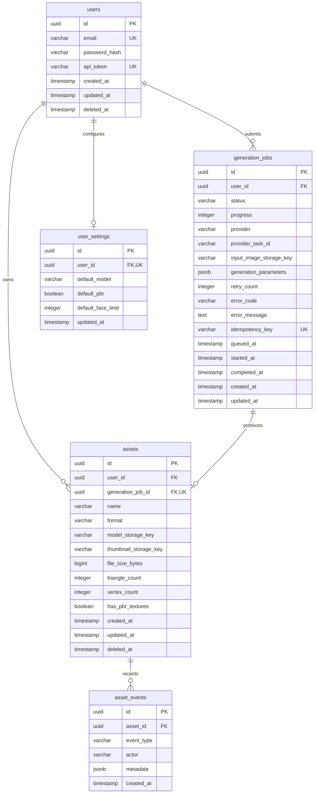

# Database Schema Specification & Data Architecture

**Database Engine:** PostgreSQL 16+  
**ORM / Migration Tooling:** Prisma ORM / Kysely  
**Document Version:** 1.0.0  
**Data Lead:** Database Architect  

---

## 1. Entity Relationship (ER) Diagram



---

## 2. Table Specifications & Data Dictionaries

### 2.1 `users`
Stores user identities, credentials, and API access tokens for web and Blender authentication.

| Column | Type | Constraints | Description |
| :--- | :--- | :--- | :--- |
| `id` | `UUID` | `PRIMARY KEY DEFAULT gen_random_uuid()` | Unique user identifier. |
| `email` | `VARCHAR(255)` | `NOT NULL UNIQUE` | User's verified email address. |
| `password_hash` | `VARCHAR(255)` | `NOT NULL` | Argon2id password hash. |
| `api_token` | `VARCHAR(64)` | `NOT NULL UNIQUE` | Personal API token used by Blender add-on (`bai_...`). |
| `created_at` | `TIMESTAMPTZ` | `NOT NULL DEFAULT NOW()` | Account creation timestamp. |
| `updated_at` | `TIMESTAMPTZ` | `NOT NULL DEFAULT NOW()` | Last profile update timestamp. |
| `deleted_at` | `TIMESTAMPTZ` | `NULL` | Soft-deletion timestamp. |

**Indexes:**
- `CREATE INDEX idx_users_email ON users(email) WHERE deleted_at IS NULL;`
- `CREATE INDEX idx_users_api_token ON users(api_token) WHERE deleted_at IS NULL;`

---

### 2.2 `user_settings`
Stores user-level defaults for 3D generation parameters.

| Column | Type | Constraints | Description |
| :--- | :--- | :--- | :--- |
| `id` | `UUID` | `PRIMARY KEY DEFAULT gen_random_uuid()` | Unique settings record identifier. |
| `user_id` | `UUID` | `NOT NULL UNIQUE REFERENCES users(id) ON DELETE CASCADE` | Associated user. |
| `default_model` | `VARCHAR(64)` | `NOT NULL DEFAULT 'v3.1-20260211'` | Preferred Tripo3D model version. |
| `default_pbr` | `BOOLEAN` | `NOT NULL DEFAULT TRUE` | Whether PBR maps are generated by default. |
| `default_face_limit` | `INTEGER` | `NULL` | Optional default polygon limit. |
| `updated_at` | `TIMESTAMPTZ` | `NOT NULL DEFAULT NOW()` | Last update timestamp. |

---

### 2.3 `generation_jobs`
Tracks the asynchronous lifecycle of every 3D generation request.

| Column | Type | Constraints | Description |
| :--- | :--- | :--- | :--- |
| `id` | `UUID` | `PRIMARY KEY DEFAULT gen_random_uuid()` | Unique generation job identifier. |
| `user_id` | `UUID` | `NOT NULL REFERENCES users(id) ON DELETE CASCADE` | Job owner. |
| `status` | `VARCHAR(32)` | `NOT NULL CHECK (status IN ('queued', 'processing', 'completed', 'failed', 'cancelled'))` | Job state. |
| `progress` | `INTEGER` | `NOT NULL DEFAULT 0 CHECK (progress >= 0 AND progress <= 100)` | Completion percentage. |
| `provider` | `VARCHAR(32)` | `NOT NULL DEFAULT 'tripo3d'` | AI backend service (`tripo3d` or `mock`). |
| `provider_task_id` | `VARCHAR(128)` | `NULL` | Tripo3D task identifier (`task_...`). |
| `input_image_storage_key`| `VARCHAR(512)`| `NOT NULL` | S3 key for the input reference image. |
| `generation_parameters` | `JSONB` | `NOT NULL DEFAULT '{}'` | Options passed (texture, PBR, model, etc.). |
| `retry_count` | `INTEGER` | `NOT NULL DEFAULT 0` | Number of worker execution retries. |
| `error_code` | `VARCHAR(64)` | `NULL` | Machine-readable error code (`TIMEOUT`, etc.). |
| `error_message` | `TEXT` | `NULL` | Safe, user-facing error message. |
| `idempotency_key` | `VARCHAR(128)` | `NULL UNIQUE` | Client request deduplication key. |
| `queued_at` | `TIMESTAMPTZ` | `NOT NULL DEFAULT NOW()` | Time entered task queue. |
| `started_at` | `TIMESTAMPTZ` | `NULL` | Time worker began processing. |
| `completed_at` | `TIMESTAMPTZ` | `NULL` | Time job finished (or failed). |
| `created_at` | `TIMESTAMPTZ` | `NOT NULL DEFAULT NOW()` | Record creation timestamp. |
| `updated_at` | `TIMESTAMPTZ` | `NOT NULL DEFAULT NOW()` | Last state change timestamp. |

**Indexes:**
- `CREATE INDEX idx_jobs_user_id ON generation_jobs(user_id, created_at DESC);`
- `CREATE INDEX idx_jobs_status ON generation_jobs(status) WHERE status IN ('queued', 'processing');`
- `CREATE INDEX idx_jobs_provider_task_id ON generation_jobs(provider_task_id);`

---

### 2.4 `assets`
Stores permanently retained 3D assets ingested into private object storage.

| Column | Type | Constraints | Description |
| :--- | :--- | :--- | :--- |
| `id` | `UUID` | `PRIMARY KEY DEFAULT gen_random_uuid()` | Unique asset identifier. |
| `user_id` | `UUID` | `NOT NULL REFERENCES users(id) ON DELETE CASCADE` | Asset owner. |
| `generation_job_id` | `UUID` | `NOT NULL UNIQUE REFERENCES generation_jobs(id)` | Originating job. |
| `name` | `VARCHAR(255)` | `NOT NULL` | Asset display title. |
| `format` | `VARCHAR(16)` | `NOT NULL DEFAULT 'glb'` | File format (`glb`). |
| `model_storage_key` | `VARCHAR(512)` | `NOT NULL` | S3 path to `.glb` file (`assets/{id}/model.glb`). |
| `thumbnail_storage_key`| `VARCHAR(512)`| `NOT NULL` | S3 path to preview render (`assets/{id}/thumb.png`).|
| `file_size_bytes` | `BIGINT` | `NOT NULL` | Size in bytes. |
| `triangle_count` | `INTEGER` | `NULL` | Extracted polygon count. |
| `vertex_count` | `INTEGER` | `NULL` | Extracted vertex count. |
| `has_pbr_textures` | `BOOLEAN` | `NOT NULL DEFAULT TRUE` | Whether PBR maps are present. |
| `created_at` | `TIMESTAMPTZ` | `NOT NULL DEFAULT NOW()` | Creation timestamp. |
| `updated_at` | `TIMESTAMPTZ` | `NOT NULL DEFAULT NOW()` | Last update timestamp. |
| `deleted_at` | `TIMESTAMPTZ` | `NULL` | Soft deletion timestamp. |

**Indexes:**
- `CREATE INDEX idx_assets_user_created ON assets(user_id, created_at DESC) WHERE deleted_at IS NULL;`

---

### 2.5 `asset_events`
Audit trail of actions taken on an asset (viewed, downloaded, imported to Blender, deleted).

| Column | Type | Constraints | Description |
| :--- | :--- | :--- | :--- |
| `id` | `UUID` | `PRIMARY KEY DEFAULT gen_random_uuid()` | Event identifier. |
| `asset_id` | `UUID` | `NOT NULL REFERENCES assets(id) ON DELETE CASCADE` | Associated asset. |
| `event_type` | `VARCHAR(64)` | `NOT NULL` | Action: `created`, `downloaded`, `blender_imported`, `deleted`. |
| `actor` | `VARCHAR(32)` | `NOT NULL` | Source: `web_ui`, `blender_addon`, `system`. |
| `metadata` | `JSONB` | `NOT NULL DEFAULT '{}'` | Additional event context (IP, client version). |
| `created_at` | `TIMESTAMPTZ` | `NOT NULL DEFAULT NOW()` | Event timestamp. |

---

## 3. Job State Machine & Transitions

```
                    ┌──────────────┐
                    │    queued    │
                    └──────┬───────┘
                           │ Worker picks up job
                           ▼
                    ┌──────────────┐
       ┌───────────►│  processing  ├────────────┐
       │            └──────┬───────┘            │
       │                   │                    │
Task cancellation          │ Asset ingested &   │ Provider error,
by user                    │ verified           │ timeout, credit
       ▼                   ▼                    ▼
┌──────────────┐    ┌──────────────┐    ┌──────────────┐
│  cancelled   │    │  completed   │    │    failed    │
└──────────────┘    └──────────────┘    └──────────────┘
```

---

## 4. Example Data Records (Sanitized)

```sql
-- Sample User
INSERT INTO users (id, email, password_hash, api_token) VALUES 
('a0eebc99-9c0b-4ef8-bb6d-6bb9bd380a11', 'creator@example.com', '$argon2id$v=19$m=65536,t=3,p=4$dummyhash', 'bai_f7d8c91a0b2c3d4e5f6a7b8c9d0e1f2a');

-- Sample Generation Job
INSERT INTO generation_jobs (
    id, user_id, status, progress, provider, provider_task_id, 
    input_image_storage_key, generation_parameters, queued_at, started_at, completed_at
) VALUES (
    'b1eebc99-9c0b-4ef8-bb6d-6bb9bd380b22', 
    'a0eebc99-9c0b-4ef8-bb6d-6bb9bd380a11',
    'completed', 100, 'tripo3d', 'task_sample_tripo_89712',
    'uploads/a0eebc99/wooden_chair.png',
    '{"model": "v3.1-20260211", "texture": true, "pbr": true}',
    NOW() - INTERVAL '45 seconds', NOW() - INTERVAL '43 seconds', NOW()
);

-- Sample Durable Asset
INSERT INTO assets (
    id, user_id, generation_job_id, name, format, 
    model_storage_key, thumbnail_storage_key, file_size_bytes, 
    triangle_count, vertex_count, has_pbr_textures
) VALUES (
    'c2eebc99-9c0b-4ef8-bb6d-6bb9bd380c33',
    'a0eebc99-9c0b-4ef8-bb6d-6bb9bd380a11',
    'b1eebc99-9c0b-4ef8-bb6d-6bb9bd380b22',
    'Wooden Chair Concept', 'glb',
    'assets/c2eebc99/model.glb', 'assets/c2eebc99/thumbnail.png',
    4812940, 32410, 16802, true
);
```

---

## 5. Migration Strategy

1. **Schema Definition:** Authoritative schema declared in `packages/database/prisma/schema.prisma` (or SQL migration files).
2. **Deterministic Migrations:** Run via `pnpm --filter @blender-ai/database prisma migrate deploy` in production.
3. **Rollback Safety:** All schema modifications must be additive (no breaking column drops without prior deprecation phase).
